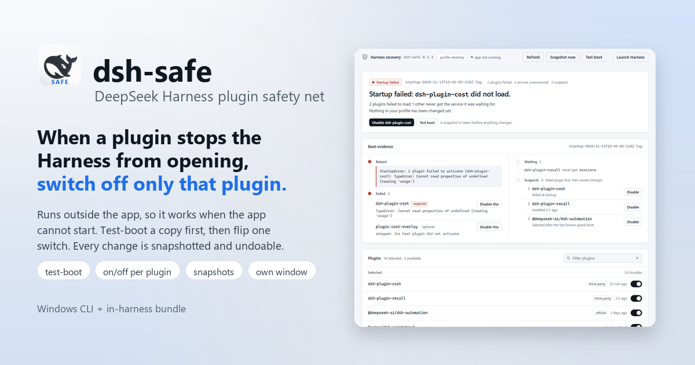
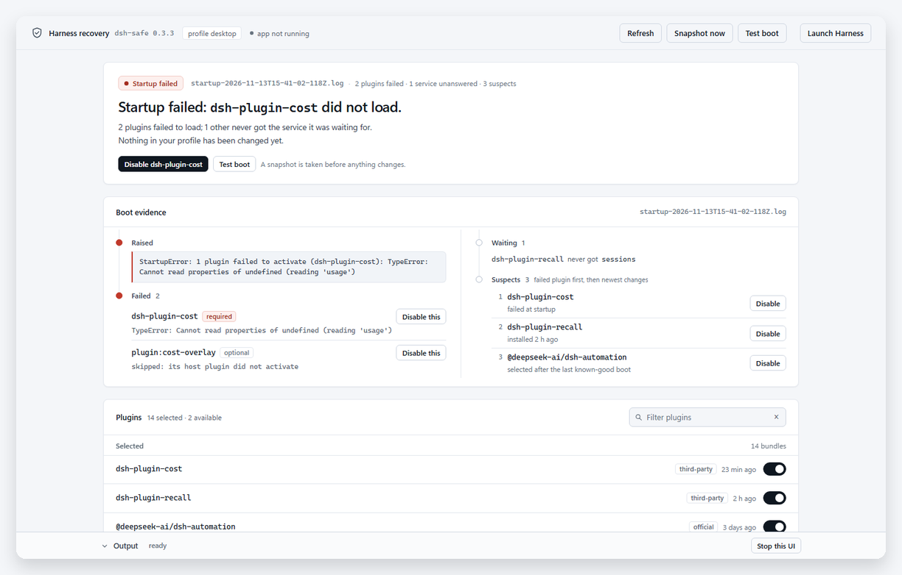
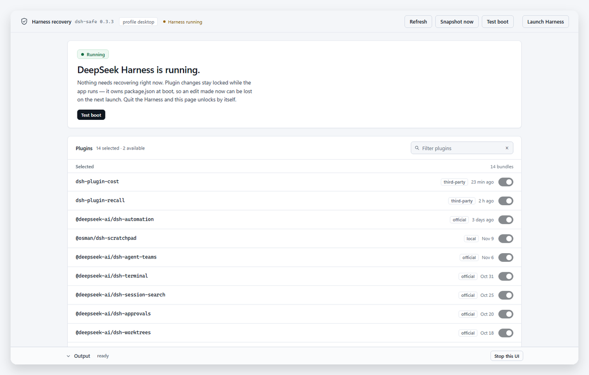
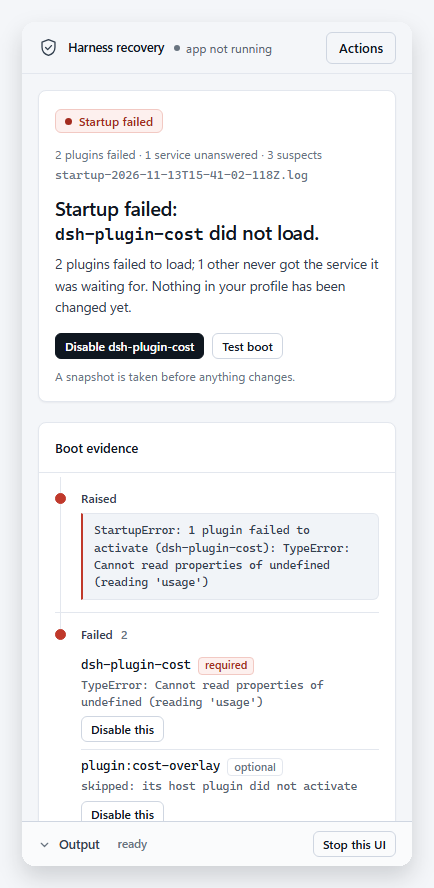

A plugin can stop DeepSeek Harness from opening. `dsh-safe` is the tool that
gets you out: it runs **outside** the app, shows what actually failed, and lets
you switch off **one** plugin instead of all of them.


---

## Why not the built-in dialog

The Harness ships a recovery dialog ("Disable third-party plugins, back up the
profile patch and restart"). It fires only on a crash, and it is all-or-nothing:
it drops *every* third-party bundle and detaches the whole patch layer. When one
plugin is broken, that is a lot of collateral damage — and it never appears at
all when the app hangs on *loading* instead of crashing.

`dsh-safe` edits the profile files directly from a terminal or its own window, so
it does not need the broken app to boot. You get the failure, the plugin that
caused it, and one switch per plugin.

## What the recovery window looks like



A failed boot: the verdict names the plugin, **Boot evidence** shows the raised
exception and the plugins that failed or waited for a service, and the plugin
switches and recovery points sit underneath, newest change first.



While the Harness is up, nothing is broken as far as this page can see, so it
says **Running**, hides the boot evidence, and locks the switches — the app owns
`package.json` at boot, so an edit made now can be lost on the next launch. The
page unlocks by itself once you quit the app.

<p align="center">
  
</p>

Narrow screens get a single column and the header buttons fold into **Actions**.

## Quick start

```bat
dsh-safe.cmd status      :: where the profile is, what was installed recently
dsh-safe.cmd recover     :: what failed in the newest startup log, and why
dsh-safe-ui.cmd          :: the recovery window (works while the app is down)
```

Take a snapshot before any risky change:

```bat
dsh-safe.cmd snapshot -l before-thing-x
```

## Install

As a plugin, which adds two in-harness tools:

```bat
dsh plugin --profile desktop add github:osman3n/dsh-safe
```

Restart DeepSeek Harness. The plugin manager lists **dsh-safe** and the model can
call `dsh_safe_status` and `dsh_safe_snapshot`. The CLI ships in the same package,
so the recovery commands keep working.

As a standalone CLI there is no install step: clone the repo, open a terminal in
the package folder and run `dsh-safe.cmd` (or `node dsh-safe.mjs`). The only
dependency is Node.js 22+.

The recovery CLI targets Windows (it uses `tasklist`, `cmd.exe` and the desktop
executable); the in-harness tools are plain Node and work wherever the Harness
runs. The plugin half is a convenience, not the recovery path — when the Harness
cannot boot, nothing inside it can run.

| Tool | What it does |
| --- | --- |
| `dsh_safe_status` | Active profile, selected bundles (and which are local links), recent snapshots, last known-good snapshot, last test boot, last recovery, newest startup-failure log with the plugins that failed or waited for services |
| `dsh_safe_snapshot` | Copies `package.json`, `cordis.yml` and `cordis.patch.yml` into `$DSH_HOME/safety/snapshots/<id>/`; optional `label` and `note` |

Both call the same functions as the CLI, so a snapshot taken by the model is the
snapshot `dsh-safe snapshots` lists and `dsh-safe restore` accepts. Neither tool
changes the plugin selection: disabling and restoring happen from the CLI while
the app is closed.

## The commands

| Command | What it does |
| --- | --- |
| `status` | Profile path, whether the app is running, bundle/local counts, recent plugin operations, crash evidence |
| `snapshot [-l label]` | Copies `package.json` + `cordis.yml` + `cordis.patch.yml` into a timestamped snapshot |
| `snapshots` / `list` | Lists snapshots (`--json` for scripting) |
| `restore [id\|latest]` | Puts a snapshot back; the current state is saved as a new snapshot first |
| `plugins` / `bundles` | Numbered list of selected bundles with a `[core/local/official/third-party/installed]` tag |
| `disable [name...]` | Removes bundles from `dsh.profile.bundles`; no names = interactive picker |
| `enable [name...]` | Adds installed bundles back; no names = interactive picker |
| `try` | Clone this profile under a temporary name, boot it in an isolated `DSH_HOME`, wait for the web server, probe it, then delete the clone |
| `ui` | Local recovery page: crash evidence, one on/off switch per plugin, snapshots, **test boot**, **launch** |
| `watch` | Serves the recovery page and opens it when Harness writes a new crash or startup-failure log |
| `watch --install` | Starts that watcher hidden at every Windows sign-in (`--uninstall` removes it) |
| `icon` | Copies `app.ico` to `%LOCALAPPDATA%\dsh-safe\app.ico` where the shell can draw it, and prints the path |
| `recover` | Reads the newest startup log and explains which plugin failed and why |
| `recover --pick --apply` | Shows suspect plugins, lets you pick which to disable, applies it |
| `recover --apply` | Disables the newest safe suspect |
| `recover --safe-mode --apply` | Keeps only `dsh-base` + `dsh-web-app` (profile still intact) |
| `open` | Runs `try`; if the boot fails it auto-disables the mapped culprit, retries, then launches the app |

`disable`/`enable` accept names or entry ids (`include:workflow-kit`), and
`--dry-run` prints the plan. Core bundles (`@deepseek-ai/dsh-base`,
`@deepseek-ai/dsh-web-app`) are refused unless you pass `--force` — disabling them
takes the whole app down.

## Recovery recipes

**1. The app crashes on launch (dialog says "Host process exited").**
Don't reach for the built-in "Disable third-party plugins" button unless you want
to lose every third-party bundle.

```bat
dsh-safe.cmd recover --pick --apply
dsh-safe.cmd open
```

**2. The app opens and hangs on "loading" forever.**
The built-in dialog never appears for a hang. Run `dsh-safe.cmd recover` first —
the startup log usually names the plugin that threw during `apply()` — then
`dsh-safe.cmd recover --pick --apply`.

**3. You installed a plugin and now nothing works.**
`status` shows the newest `install/*` operation, `plugins` shows the bundle list.
Disable the last thing you installed:

```bat
dsh-safe.cmd disable @scope/package-name
```

**4. You want to test a profile change before letting it near the real app.**
`dsh-safe.cmd try` — same bundles, same `node_modules` (via a junction), but a
throwaway profile name and `DSH_HOME`. The real profile is only read.

**5. You disabled the wrong thing.**
`dsh-safe.cmd snapshots`, then `dsh-safe.cmd restore <id>`. `restore` with no id
restores the newest snapshot; either way the current state is backed up first, so
restore is itself undoable.

## The recovery UI

`dsh-safe-ui.cmd` (or `dsh-safe.cmd ui`) serves a small page on `127.0.0.1` and
opens it as its own window: title bar, taskbar entry, its own icon, no tabs and no
address bar. It is a normal Node process, so it works while the Harness is
crashed, hung, or closed. `--browser` opens a normal tab instead; `--no-browser`
only serves the page and prints its URL.

The icon is the DeepSeek Harness whale tile with **SAFE** in blue underneath, so
the recovery app reads as the safe build of the app it repairs. At 16–48 px the
word becomes a solid blue bar in the same place, because four letters blur into a
smudge that small — Windows picks the nearest size on its own.

Windows will not draw a shortcut icon straight out of this folder: the project
carries a restrictive ACL and the shell silently falls back to a blank page. So
`dsh-safe icon` copies `app.ico` to `%LOCALAPPDATA%\dsh-safe\app.ico`, the window
and watcher refresh that copy when they start, and the shortcut points there. Run
`dsh-safe icon` after moving the package if the taskbar icon ever goes blank.

On the page, below the verdict band:

- **Boot evidence** — the raised error, the failed plugins (first exception plus a
  per-row **Disable this**), the plugins that waited for services, and the suspect
  list (failed plugin first, then newest changes) in a scrollable column.
- **Plugins** — every selected bundle with its own on/off switch, a filter box and
  a `kind` badge. **On** means the bundle is loaded; flipping it off removes it
  from the profile after taking a snapshot, so **Recovery points** can put it back.
  Core bundles stay on with a locked switch. Installed bundles that are not
  selected appear below with the switch off. The list is sorted **newest install
  or update first**, using the app's plugin-operation log plus `node_modules`
  timestamps, so the plugin you just added sits near the top.
- **Recovery points** — the newest 25 snapshots, each with **Restore**. Until a
  boot has been verified it says so instead of pretending there is a good point.
- **Recent changes** — recent plugin operations, so you can spot the change that
  broke the boot, next to a collapsible **Output** dock showing what each action
  did.

Mutating buttons are blocked while DeepSeek Harness is running, and the page says
so in a banner. The server binds to `127.0.0.1` only and every URL carries a random
token, so another local page cannot drive it. **Stop this UI** (or Ctrl+C) ends it.

**One-click safe reopen:** double-click the *DeepSeek Harness (Safe)* desktop
shortcut. It opens the recovery window immediately, even while Harness is running,
so you can inspect the profile and choose plugins before touching anything. Use
**Test boot** for a sandbox preflight, fix what is broken, then **Launch
Harness** — the page shuts itself down. `dsh-safe.cmd open` (without `--ui`) keeps
the older preflight-then-launch behaviour.

**No console window.** The shortcut runs `dsh-safe-open.vbs` through `wscript`, so
nothing flashes on screen; everything the launcher prints goes to
`%USERPROFILE%\.dsh\safety\ui.log`. Closing the window stops the server by itself:
the page pings every 20 seconds, and after two quiet minutes the Node process
exits. `dsh-safe-open.cmd` still exists for terminal users.

## Automatically on crash

`dsh-safe watch` is a small background guard. It serves the recovery page and
watches two places for new failure evidence:

- `%APPDATA%\@deepseek-ai\dsh-desktop\logs\crash-*.log` — written by the desktop
  app when a boot or renderer fails;
- `%USERPROFILE%\.dsh\logs\startup-*.log` — written when the host startup fails.

When a new failure appears it appends the error line to `~/.dsh/safety/watch.log`
and opens the recovery page. If the app is still showing its own crash dialog the
page reports "Harness is running"; it unlocks by itself once you quit, because it
keeps polling while the app is up.

```bat
dsh-safe watch --install
```

That writes `dsh-safe-watch.vbs` into
`%APPDATA%\Microsoft\Windows\Start Menu\Programs\Startup\`. Remove it with
`dsh-safe watch --uninstall`, or delete that file. The watcher remembers the full
path of `dsh-safe.mjs`, so re-run `--install` if you move this folder.

## Automatic images

The bundle keeps a short history of the profile without asking. Nothing is
prompted or printed; a small log sits at `$DSH_HOME/safety/auto.log`.

| When | Label |
| --- | --- |
| a plugin install, enable, remove or update settles successfully (applied, or restart required) | `plugin-change` |
| the Harness version changes and the new version stays up for 20 s | `dsh-update` |
| just before an approved git-autobackup run | `auto-backup` |

A plugin change is imaged only after the operation has **settled with no error**
and the app has been quiet for 5 s, so writing or fixing a plugin does not fill
the history with half-finished states. The `auto-backup` image is skipped when a
`plugin-change` or `dsh-update` image was taken in the last five minutes, so one
change does not use two slots.

The last **10** automatic images are kept; the oldest is deleted when a new one
arrives. A daily **stable** image (`stable-YYYY-MM-DD`) is taken at the start of
the day — at the first boot, or at 00:05 if Harness stays open — and does not
count against the 10. Stable images are not pruned: the folder gains one small
folder per day (~60 KB each), and you can delete old ones under
`$DSH_HOME/safety/snapshots` whenever you like.

`dsh-safe snapshots` lists them all; `dsh-safe restore <id>` puts one back. The
backup build copies the whole snapshots folder, so the images also travel with
your git-autobackup history.

## How `try` decides the boot is "healthy"

It starts the clone with `dsh --profile <trial> --no-open --port 0`, waits for the
`dsh web: http://127.0.0.1:...` line, then probes the URL until it answers. Only
then does it declare success after a short grace period (`--grace 3`). A crash
during boot shows up as a lower exit code or a `Failed plugins` block in the trial
startup log. Successful trials delete themselves; failed ones are kept under
`%USERPROFILE%\.dsh\safety\trials\` for inspection (add `--keep` to keep a
successful one).

## Safety model

- Close the Harness before `disable`, `enable`, `restore`, or `recover --apply`.
  The app reads these files at boot and the plugin manager can also write them;
  editing while it runs invites a last-writer-wins surprise on the next launch.
  (`status`, `plugins`, `snapshots`, `recover` without `--apply`, and `try` are
  read-only and safe while the app runs.)
- The real profile is never modified by `try`/`open`'s preflight. `disable`,
  `enable`, `restore`, and `recover --apply` all take a snapshot first.
- Edits are atomic (write to a temp file, then rename).
- `open` refuses to launch a second instance while the app is running.
- The desktop profile is owned by the Electron app: `dsh --profile desktop
  --dump-config` fails with "managed exclusively by the Electron application".
  That is why `try` clones it under a different profile name instead of booting it
  directly.
- A plugin that throws synchronously in `apply()` is contained by the loader (the
  app still starts with a warning). What actually kills the process is an unhandled
  rejection or uncaught exception — that is the crash this tool is designed to
  recover from, because an in-process plugin cannot catch it.

## Files it writes

| Path | Contents |
| --- | --- |
| `%USERPROFILE%\.dsh\safety\snapshots\<id>\` | `package.json`, `cordis.yml`, `cordis.patch.yml`, `meta.json` |
| `%USERPROFILE%\.dsh\safety\trials\<id>\` | disposable profile clone + isolated `home` |
| `%USERPROFILE%\.dsh\safety\incidents\` | one JSON per failed preflight (`try`/`open`) |
| `%USERPROFILE%\.dsh\safety\state.json` | snapshot counter, last trial |
| `%USERPROFILE%\.dsh\safety\ui.log`, `watch.log`, `auto.log` | launcher, watcher and automatic-image logs |

Environment overrides: `DSH_HOME`, `DSH_PROFILE` (default `desktop`),
`DSH_SAFE_DSH` (path to a different `dsh` launcher), `DSH_DESKTOP_EXE` (path to
`DeepSeek Harness.exe`), `DSH_SAFE_FORCE_TTY=1` (force the picker when input is
piped, useful for tests), `DSH_SAFE_APP_RUNNING=0|1` (override the "is the app
running" check the UI uses to block mutations; for tests), `DSH_SAFE_UI_IDLE_MS`
(how long the window mode waits for a ping before stopping the server; default
`120000`).

## Wrappers

- `dsh-safe.cmd` — the CLI.
- `dsh-safe-ui.cmd` — `dsh-safe ui`, opens the recovery window.
- `dsh-safe-open.vbs` — the same with no console window; the desktop shortcut
  points here.
- `dsh-safe-open.cmd` — `dsh-safe open --ui` in a console. `dsh-safe.cmd open`
  still test-boots the profile and launches Harness when it is healthy.

All work from any directory; they resolve `dsh-safe.mjs` relative to themselves.
To type `dsh-safe` from anywhere, add the folder that contains `dsh-safe.cmd` to
your PATH.

---

Listed in [awesome-dsh-plugin](https://github.com/awesome-dsh-plugin/awesome-dsh-plugin).
MIT licensed.
