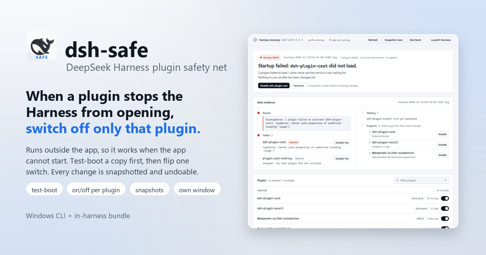
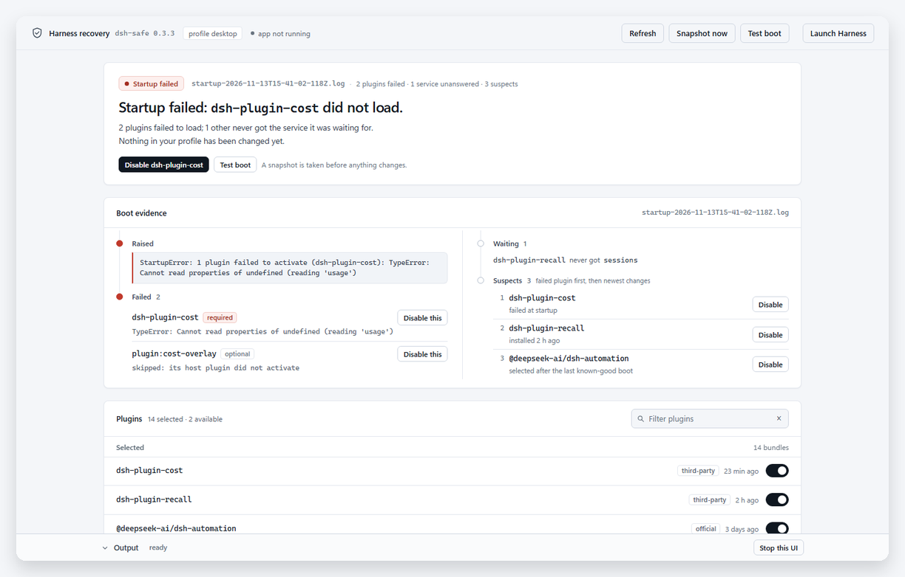
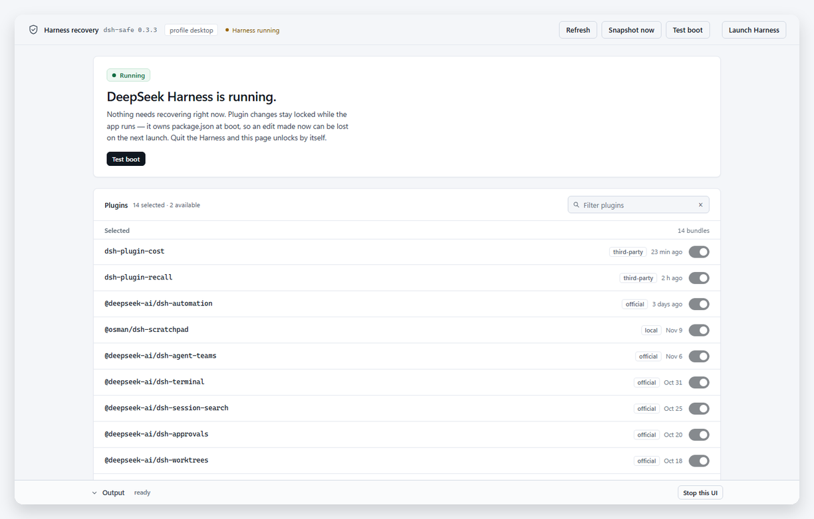
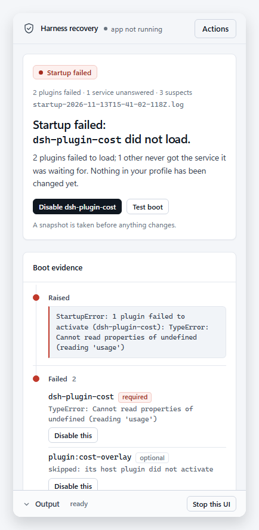

[English](README.md) · **简体中文**

一个插件就可能让 DeepSeek Harness 打不开。`dsh-safe` 就是把你救出来的工具：
它运行在应用**之外**，告诉你到底哪里失败了，并且让你只关掉**一个**插件，
而不是全部。


---

## 为什么不直接用内置对话框

Harness 自带一个恢复对话框（"禁用第三方插件、备份 profile 补丁并重启"）。它只在
崩溃时出现，而且是全有或全无：它丢掉**每一个**第三方 bundle，并摘掉整层补丁。
当只有一个插件坏掉时，这个代价太大——而当应用是**卡在加载**而不是崩溃时，
它根本不会出现。

`dsh-safe` 直接从终端或它自己的窗口修改 profile 文件，所以不需要那个已经坏掉的
应用先启动起来。你拿到的是：失败信息、肇事的插件，以及每个插件一个开关。

## 恢复窗口长什么样



一次失败的启动：结论栏点名了插件，**启动证据**显示抛出的异常，以及失败或
在等待服务的插件；插件开关和恢复点在下方，最新的变更排在最前面。



Harness 正在运行时，从这一页看什么都不算坏，所以它显示 **正在运行**、隐藏启动
证据并锁定开关——应用在启动时拥有 `package.json`，现在做的改动可能在下次启动
时丢失。退出应用后，页面会自己解锁。

<p align="center">
  
</p>

窄屏下变成单列，页头按钮收进 **操作**（Actions）。

## 快速开始

```bat
dsh-safe.cmd status      :: profile 在哪、最近装了什么
dsh-safe.cmd recover     :: 最新启动日志里什么失败了、为什么
dsh-safe-ui.cmd          :: 恢复窗口（应用没起来时也能用）
```

做任何有风险的改动前，先拍一张快照：

```bat
dsh-safe.cmd snapshot -l before-thing-x
```

## 安装

作为插件安装，会多出两个应用内工具：

```bat
dsh plugin --profile desktop add github:osman3n/dsh-safe
```

重启 DeepSeek Harness。插件管理器里会列出 **dsh-safe**，模型可以调用
`dsh_safe_status` 和 `dsh_safe_snapshot`。CLI 在同一个包里，所以恢复命令
照常可用。

作为独立 CLI 则没有安装步骤：克隆仓库，在包目录里打开终端，运行
`dsh-safe.cmd`（或 `node dsh-safe.mjs`）。唯一的依赖是 Node.js 22+。

恢复 CLI 面向 Windows（它用到 `tasklist`、`cmd.exe` 和桌面端可执行文件）；
应用内工具是纯 Node，Harness 能跑的地方都能用。插件那一半只是顺手，
不是恢复通道——当 Harness 起不来时，它内部什么都跑不了。

| 工具 | 作用 |
| --- | --- |
| `dsh_safe_status` | 当前 profile、选中的 bundle（以及哪些是本地链接）、最近的快照、最后的已知良好快照、最后一次试启动、最后一次恢复、最新的启动失败日志，以及失败或在等待服务的插件 |
| `dsh_safe_snapshot` | 把 `package.json`、`cordis.yml` 和 `cordis.patch.yml` 复制到 `$DSH_HOME/safety/snapshots/<id>/`；可选 `label` 和 `note` |

两者调用与 CLI 相同的函数，所以模型拍的快照，就是 `dsh-safe snapshots` 列出、
`dsh-safe restore` 接受的那一个。两个工具都不改变插件选择：禁用和恢复都在
应用关闭时从 CLI 做。

## 命令

| 命令 | 作用 |
| --- | --- |
| `status` | profile 路径、应用是否在运行、bundle 与本地数量、最近的插件操作、崩溃证据 |
| `snapshot [-l label]` | 把 `package.json` + `cordis.yml` + `cordis.patch.yml` 复制成一份带时间戳的快照 |
| `snapshots` / `list` | 列出快照（`--json` 供脚本使用） |
| `restore [id\|latest]` | 放回一份快照；当前状态会先被存成一份新快照 |
| `plugins` / `bundles` | 带编号列出选中的 bundle，并标注 `[core/local/official/third-party/installed]` |
| `disable [name...]` | 从 `dsh.profile.bundles` 里移除 bundle；不带名字 = 交互式选择 |
| `enable [name...]` | 把已安装的 bundle 加回来；不带名字 = 交互式选择 |
| `try` | 把这份 profile 克隆成临时名字，在独立的 `DSH_HOME` 里启动，等 web 服务起来、探测通过，然后删掉克隆 |
| `ui` | 本地恢复页面：崩溃证据、每个插件一个开关、快照、**试启动**、**启动** |
| `watch` | 提供恢复页面，并在 Harness 写入新的崩溃或启动失败日志时打开它 |
| `watch --install` | 让这个守护进程在每次 Windows 登录时隐藏启动（`--uninstall` 移除） |
| `icon` | 把 `app.ico` 复制到 `%LOCALAPPDATA%\dsh-safe\app.ico`（外壳能画图标的位置），并打印路径 |
| `recover` | 读最新的启动日志，说明哪个插件失败、为什么 |
| `recover --pick --apply` | 列出可疑插件，让你挑选要禁用哪些，然后应用 |
| `recover --apply` | 禁用最新的安全可疑项 |
| `recover --safe-mode --apply` | 只保留 `dsh-base` + `dsh-web-app`（profile 仍然完好） |
| `open` | 跑一次 `try`；如果启动失败，自动禁用映射到的肇事者、重试，然后启动应用 |

`disable`/`enable` 接受名字或条目 id（`include:workflow-kit`），`--dry-run`
只打印计划。核心 bundle（`@deepseek-ai/dsh-base`、`@deepseek-ai/dsh-web-app`）
除非加 `--force`，否则一律拒绝——关掉它们整个应用就没了。

## 恢复场景

**1. 应用一启动就崩（对话框说 "Host process exited"）。**
别急着点内置的"禁用第三方插件"，除非你愿意丢掉所有第三方 bundle。

```bat
dsh-safe.cmd recover --pick --apply
dsh-safe.cmd open
```

**2. 应用能打开，但一直卡在 "loading"。**
卡住时内置对话框从来不会出现。先跑 `dsh-safe.cmd recover`——启动日志通常会
点出在 `apply()` 里抛异常的那个插件——再跑
`dsh-safe.cmd recover --pick --apply`。

**3. 装了一个插件之后，什么都不行了。**
`status` 显示最新的 `install/*` 操作，`plugins` 显示 bundle 列表。关掉最后
装的那个：

```bat
dsh-safe.cmd disable @scope/package-name
```

**4. 想先验证一次 profile 改动，再让它靠近真实应用。**
`dsh-safe.cmd try`——同样的 bundle、同样的 `node_modules`（通过 junction），
但用一次性的 profile 名和 `DSH_HOME`。真实 profile 只被读取。

**5. 关错东西了。**
`dsh-safe.cmd snapshots`，然后 `dsh-safe.cmd restore <id>`。不带 id 的
`restore` 恢复最新快照；无论哪种，当前状态都会先备份，所以恢复本身也可撤销。

## 恢复界面

`dsh-safe-ui.cmd`（或 `dsh-safe.cmd ui`）在 `127.0.0.1` 上提供一个小页面，
并把它作为独立窗口打开：有标题栏、任务栏条目、自己的图标，没有标签页也没有
地址栏。它就是普通的 Node 进程，所以 Harness 崩了、卡了、关了都能用。
`--browser` 改为在普通标签页打开；`--no-browser` 只提供服务并打印 URL。

图标是 DeepSeek Harness 的鲸鱼方块，下面一行蓝色的 **SAFE**，让恢复应用读起来
像它所修复的那个应用的安全版本。在 16–48 px 时，这个词会变成同一位置的蓝色
实心条，因为四个字母在那个尺寸会糊成一团——Windows 会自己挑选最近的尺寸。

Windows 不会直接从本文件夹画快捷方式图标：项目带着限制性的 ACL，外壳会静默
回退成空白页面。所以 `dsh-safe icon` 把 `app.ico` 复制到
`%LOCALAPPDATA%\dsh-safe\app.ico`，窗口和守护进程启动时会刷新这份副本，
快捷方式指向那里。移动包之后如果任务栏图标变空白，重跑一次 `dsh-safe icon`。

页面上，结论栏下方：

- **启动证据** —— 抛出的错误、失败的插件（首个异常加上每行的
  **禁用此插件**）、在等待服务的插件，以及嫌疑列表（失败插件在最前，然后是
  最新的变更），都在一个可滚动的列里。
- **插件** —— 每个选中的 bundle 一个开关，外加过滤器和一个 `kind` 标签。
  **开**表示 bundle 已加载；关掉它会在拍过快照之后从 profile 里移除，所以
  **恢复点**能把它放回来。核心 bundle 保持开启、开关锁定。已安装但未选中的
  bundle 列在下方，开关是关闭的。列表按**最新安装或更新时间**排序，用的是
  应用的插件操作日志加上 `node_modules` 时间戳，所以刚加的插件就在最上面。
- **恢复点** —— 最新的 25 个快照，每个都有**恢复**。在某次启动被验证之前，
  它会如实说明，而不是假装存在一个良好的恢复点。
- **最近变更** —— 最近的插件操作，方便你找出把启动搞坏的那次改动；旁边是可
  折叠的**输出**面板，显示每个动作做了什么。

应用运行时，所有会改文件的按钮都被挡住，页面上有横幅说明。服务只绑定
`127.0.0.1`，每个 URL 都带随机 token，所以别的本地页面无法驱动它。
**停止此界面**（或 Ctrl+C）结束它。

**一键安全重开：** 双击桌面上的 *DeepSeek Harness (Safe)* 快捷方式。它会立刻
打开恢复窗口，即使 Harness 正在运行，所以你能先看清 profile、挑好插件，再动手。
用**试启动**做沙盒预检，修好问题后点**启动 Harness**——页面会自己退出。
`dsh-safe.cmd open`（不带 `--ui`）保留先预检、再启动的旧行为。

**没有控制台窗口。** 快捷方式通过 `wscript` 运行 `dsh-safe-open.vbs`，屏幕上
什么都不闪；启动器打印的一切都写进 `%USERPROFILE%\.dsh\safety\ui.log`。
关掉窗口就等于停掉服务：页面每 20 秒 ping 一次，静默两分钟后 Node 进程退出。
`dsh-safe-open.cmd` 仍为终端用户保留。

## 崩溃时自动打开

`dsh-safe watch` 是一个很小的后台守护进程。它提供恢复页面，并盯住两个地方
出现的新失败证据：

- `%APPDATA%\@deepseek-ai\dsh-desktop\logs\crash-*.log` —— 桌面应用在启动
  或渲染进程失败时写入；
- `%USERPROFILE%\.dsh\logs\startup-*.log` —— 宿主启动失败时写入。

出现新的失败时，它把错误行追加到 `~/.dsh/safety/watch.log`，并打开恢复页面。
如果应用还在显示自己的崩溃对话框，页面会报告"Harness 正在运行"；退出后它会
自己解锁，因为在应用运行期间它会持续轮询。

```bat
dsh-safe watch --install
```

这条命令会把 `dsh-safe-watch.vbs` 写进
`%APPDATA%\Microsoft\Windows\Start Menu\Programs\Startup\`。用
`dsh-safe watch --uninstall` 移除，或直接删掉那个文件。守护进程记住
`dsh-safe.mjs` 的完整路径，所以移动这个文件夹之后要重跑 `--install`。

## 自动快照

bundle 会在不问你的情况下保留一小段 profile 历史。不弹窗、不打印；日志在
`$DSH_HOME/safety/auto.log`。

| 时机 | 标签 |
| --- | --- |
| 一次插件安装、启用、移除或更新成功落定（已应用，或需要重启） | `plugin-change` |
| Harness 版本发生变化，且新版本稳定运行 20 秒 | `dsh-update` |
| 一次被批准的 git-autobackup 运行之前 | `auto-backup` |

只有当操作**无错误地落定**、并且应用已经安静 5 秒之后，才会为插件变更拍快照，
所以写插件、修插件的中间状态不会塞满历史。如果最近五分钟内已经拍过
`plugin-change` 或 `dsh-update`，`auto-backup` 这张会跳过，一次变更不占两个
位置。

保留最近 **10** 张自动快照；新的一张到来时删掉最旧的。每天开始时会拍一张
**stable** 快照（`stable-YYYY-MM-DD`）——首次启动时，或者如果 Harness 一直
开着则在 00:05——它不占这 10 个名额。stable 快照不会被清理：文件夹每天多一个
小目录（每个约 60 KB），你随时可以在 `$DSH_HOME/safety/snapshots` 下删掉旧的。

`dsh-safe snapshots` 会全部列出；`dsh-safe restore <id>` 放回其中一个。备份
构建会复制整个快照文件夹，所以这些快照也会跟着你的 git-autobackup 历史一起走。

## `try` 如何判定启动是"健康"的

它用 `dsh --profile <trial> --no-open --port 0` 启动克隆，等待
`dsh web: http://127.0.0.1:...` 这一行出现，然后不断探测该 URL 直到有响应。
只有到这时，再经过一小段宽限时间（`--grace 3`）才宣布成功。启动期间的崩溃会
表现为更低的退出码，或试启动日志里的 `Failed plugins` 块。成功的试启动会自己
删掉；失败的留在 `%USERPROFILE%\.dsh\safety\trials\` 供检查（加 `--keep`
可以保留一次成功的）。

## 安全模型

- 在执行 `disable`、`enable`、`restore` 或 `recover --apply` 之前先关闭 Harness。
  应用在启动时读这些文件，插件管理器也可能写它们；在它运行时改，下次启动就可能
  撞上"最后写入者获胜"的意外。（`status`、`plugins`、`snapshots`、不带
  `--apply` 的 `recover`，以及 `try` 都只读，应用运行时是安全的。）
- `try`/`open` 的预检从不修改真实 profile。`disable`、`enable`、`restore` 和
  `recover --apply` 都会先拍快照。
- 所有写入都是原子的（先写临时文件，再 rename）。
- 应用运行时，`open` 拒绝再启动第二个实例。
- 桌面 profile 归 Electron 应用所有：`dsh --profile desktop --dump-config` 会
  失败并提示 "managed exclusively by the Electron application"。这就是为什么
  `try` 用另一个 profile 名克隆它，而不是直接启动它。
- 在 `apply()` 里同步抛异常的插件会被加载器兜住（应用仍会带着警告启动）。真正
  杀死进程的是未处理的 rejection 或未捕获的异常——那才是这个工具要恢复的崩溃，
  因为进程内的插件拦不住它。

## 它写哪些文件

| 路径 | 内容 |
| --- | --- |
| `%USERPROFILE%\.dsh\safety\snapshots\<id>\` | `package.json`、`cordis.yml`、`cordis.patch.yml`、`meta.json` |
| `%USERPROFILE%\.dsh\safety\trials\<id>\` | 一次性的 profile 克隆 + 独立的 `home` |
| `%USERPROFILE%\.dsh\safety\incidents\` | 每次失败的预检一个 JSON（`try`/`open`） |
| `%USERPROFILE%\.dsh\safety\state.json` | 快照计数器、最近一次试启动 |
| `%USERPROFILE%\.dsh\safety\ui.log`、`watch.log`、`auto.log` | 启动器、守护进程和自动快照的日志 |

环境变量覆盖：`DSH_HOME`、`DSH_PROFILE`（默认 `desktop`）、`DSH_SAFE_DSH`
（指向另一个 `dsh` 启动器）、`DSH_DESKTOP_EXE`（指向
`DeepSeek Harness.exe`）、`DSH_SAFE_FORCE_TTY=1`（输入被管道时强制使用选择器，
便于测试）、`DSH_SAFE_APP_RUNNING=0|1`（覆盖 UI 用来阻止修改的"应用是否在
运行"判断；用于测试）、`DSH_SAFE_UI_IDLE_MS`（窗口模式在停止服务前等多久的
ping；默认 `120000`）。

## 包装脚本

- `dsh-safe.cmd` —— CLI。
- `dsh-safe-ui.cmd` —— `dsh-safe ui`，打开恢复窗口。
- `dsh-safe-open.vbs` —— 同上，但没有控制台窗口；桌面快捷方式指向这里。
- `dsh-safe-open.cmd` —— 在控制台里跑 `dsh-safe open --ui`。`dsh-safe.cmd open`
  仍然会先试启动 profile，健康时再启动 Harness。

它们在任何目录下都能用；会相对自身位置解析 `dsh-safe.mjs`。想在任何地方都能
输入 `dsh-safe`，就把包含 `dsh-safe.cmd` 的文件夹加进 PATH。

---

已收录于 [awesome-dsh-plugin](https://github.com/awesome-dsh-plugin/awesome-dsh-plugin)。
MIT 许可。
